# Orbit Explorer: an orbital digital twin

**Every tracked object in Earth orbit, propagated live in the browser, with Starlink laser-link routing, conjunction screening and coverage analysis. All of it is built from first principles and checked against published references.**

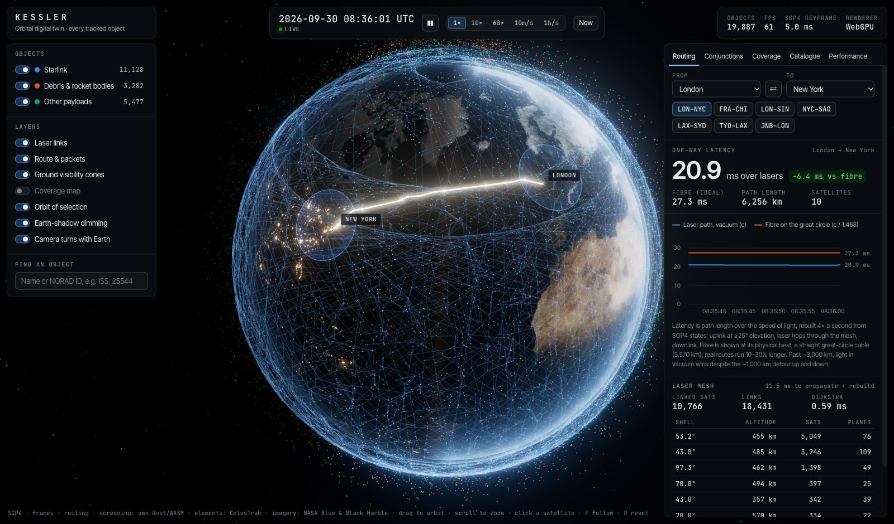

<p align="center">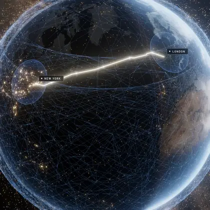<br><sub>10 min/s: satellites move, the mesh rebuilds and the London → New York path re-routes.</sub></p>

<p align="center"><b><a href="docs/media/orbit-explorer-x.mp4">▶ Watch the 90-second demo</a></b> <sub>(1080p, 60 fps): the ISS, laser routing, a 34 m conjunction, the Moon and Mars, Jupiter and Saturn, out to the Oort cloud</sub></p>

It also flies to **every planet, the Moon and out to the Oort cloud**. Every known moon of Mars and the giant planets (all 115 of Jupiter's, 290 of Saturn's, 28 of Uranus' and 16 of Neptune's) and every spacecraft orbiting another world (LRO, Danuri, MRO, Juno, BepiColombo arriving at Mercury, and more) fly on JPL's own trajectories. The Moon and Mars have 16k LRO and Viking maps with laser-altimeter relief, Mercury MESSENGER's, Venus Magellan's radar under its clouds, the giants Hubble's 2025 global maps and Saturn its rings. Out past Neptune lie the real Kuiper belt (7,299 objects), the heliosphere's edges, a model of the Oort cloud, and **Voyager 1 and 2** on their actual paths since 1977, 172 and 144 au out. A relay planner shows when a rover on the Moon or Mars can talk to Earth, and how long the signal takes.

<p align="center">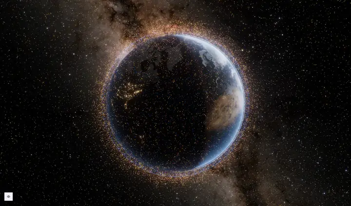<br><sub>Earth to the Moon: the camera climbs away, turns toward the destination and arrives on the lit side, with the lunar orbiters' paths.</sub></p>

<table>
  <tr>
    <td>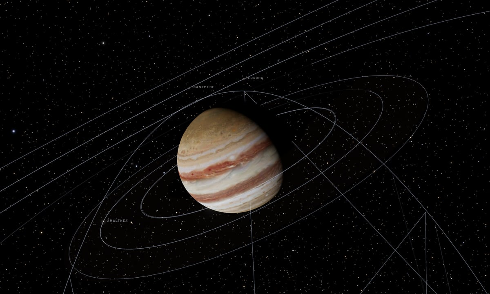</td>
    <td>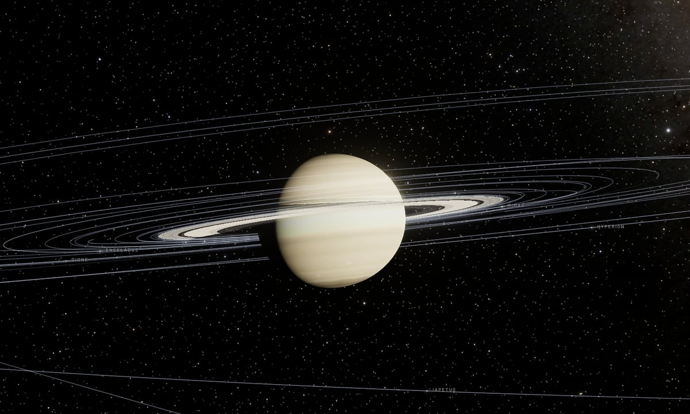</td>
  </tr>
  <tr>
    <td align="center"><sub><b>Jupiter</b> · Hubble OPAL, Dec 2025<br>115 moons and Juno</sub></td>
    <td align="center"><sub><b>Saturn</b> · rings near edge-on in 2026<br>290 moons, Cassini edges and gaps</sub></td>
  </tr>
  <tr>
    <td>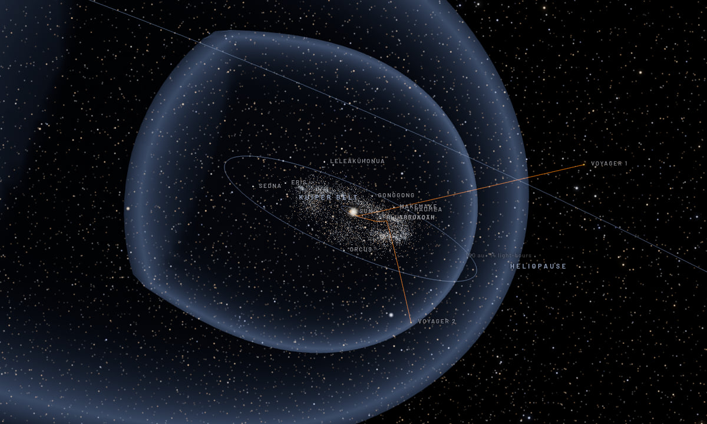</td>
    <td>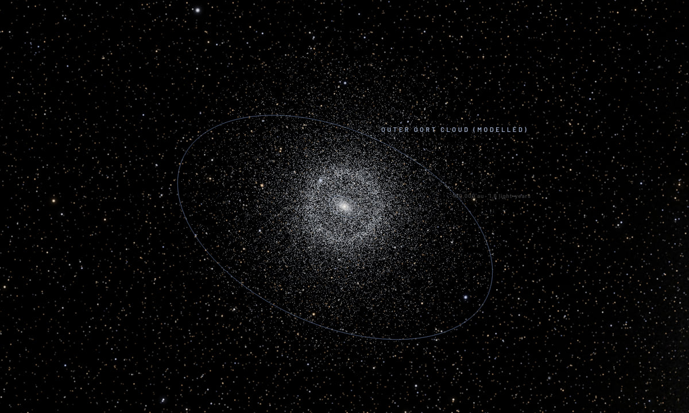</td>
  </tr>
  <tr>
    <td align="center"><sub><b>Leaving the Sun</b> · the Voyagers past the<br>termination shock, heliopause and Kuiper belt</sub></td>
    <td align="center"><sub><b>The Oort cloud</b> · a model, 2,000 to 100,000 au<br>sunlight takes 1.6 years to reach its edge</sub></td>
  </tr>
</table>

A packet from London to New York over Starlink's lasers takes **~21 ms**. The best fiber possible, a straight cable along the great circle, takes **27.3 ms**. The twin computes that difference live from the satellites' real positions, and shows the path hop by hop.

| | What Orbit Explorer computes | How it is checked |
|---|---|---|
| **Orbits** | SGP4/SDP4 written from the model definition (Vallado et al. 2006), including deep-space resonance and every `sgp4fix`. TEME → ECEF → WGS-84 geodetic, Sun position, conical Earth-shadow model. | **666/666** Vallado verification states to **0.10 mm**, and the reference's 7 error cases reproduced. **89.7% within 1 µm** of satellite.js across the live catalog, median 2 nm (worst 13 mm, on a 14-day high-elliptical orbit); why not bit for bit is under *Exact to the model, not to the bit*. The `sgp4` crate agrees to **0.7 µm**. Meeus 25.a Sun; published sunrise times to < 2 min. |
| **Laser links** | Shells and orbital planes recovered from mean elements by gap clustering; +Grid topology rebuilt every 250 ms; Dijkstra from ground terminal to ground terminal. | Synthetic Walker shells give exactly 2N links; path length equals the sum of its hops; a test proves the result is never shorter than the chord. |
| **Conjunctions** | All-vs-all screening with a sorted spatial grid and search radii sized from each object's top speed, so no encounter between samples can be missed; a linear TCA estimate, then Newton refinement on full SGP4 states. | Identical results at 10, 20, 60 and 120 s steps (**60,756 encounters < 5 km over 24 h, every step size**), including a transfer orbit meeting a LEO satellite head-on at ~18 km/s midway between samples. Grid == brute force, pair for pair. |
| **Coverage** | Visibility-cap stamping on a 2° grid (O(sats × cap) rather than O(sats × cells)). | Stamp == brute-force cell test on every cell; cap angle matches the textbook value. |
| **Moon & Mars** | Moon (MiniMoon + 31 Meeus distance terms), Mars and Sun (Standish elements) in the equator of date; IAU 2009 rotation models; 12 orbiters and moons sampled from JPL Horizons and Hermite-interpolated; relay passes over a surface site. | Against Horizons over 2025–27: Moon **≤ 0.7′ and 6 km**, Mars **≤ 0.4′**, Sun **< 1′**; the Moon's libration (sub-Earth point) to **0.013°**, Mars' sub-Earth longitude to **0.012°** (light time included). Interpolation **≤ 16 m**, measured by decimation. |
| **Planets & moons** | Mercury, Venus, the giants and the Earth they're seen from: VSOP87 truncated to 979 terms; IAU 2015 rotation (Jupiter's clouds on System II). Every known moon: sampled tracks for the ~55 that circle in under 20 days, osculating elements and two-body motion for the ~400 slow irregulars. The Voyagers' paths since launch. | Positions against Horizons over 2025–27 **≤ 7″** (Venus at its closest; the other five ≤ 3.6″); sub-Earth longitudes of all six to **0.2°**. Track interpolation **< 50 m** for 99.9% of samples; two-body motion **< 0.1%** of a moon's distance after 12 days, against Horizons. |

## Numbers

Apple M1. Native rows: release build, one thread. Browser rows: Chrome 155, production build. 32,583 objects: the full public catalog from Space-Track, Oct 9, 2026.

| | |
|---|---|
| Render | **60 fps** at the MacBook Air's own resolution (1440×900 at 2×); all per-frame JavaScript takes **~2.6 ms**, interpolating all 32,583 positions **0.22 ms** of it. The frame is GPU-bound: on a 4K external display the same M1 ran at 12–40 fps depending on the browser (measured at 19,887 objects; see *Limits*) |
| SGP4, all objects | **8.6 ms** native (264 ns/object) · **~6 ms** per keyframe across 4 WASM workers |
| Keyframe interpolation error (cubic Hermite) | **2.5 m** worst case at 60 s spacing, for COSMOS 1174, a dead satellite on a 367 × 1,028 km orbit (near-circular orbits stay near 1 m) · 0.28 km at 300 s (1 h/s time warp) |
| Laser mesh rebuild | 10,847 linked satellites, 17,719 links in **2.6 ms** · Dijkstra **0.33 ms** |
| Conjunction sieve, one instant, pairs < 10 km | spatial grid **1.5 ms** vs all pairs **638 ms** (**423×**); **1,522×** at 100k objects · ~460× in WASM |
| 24 h screen, whole catalog, 5 km | **23 s** native (1,441 time steps, 460 M sieve pairs, 60,756 encounters) · 6 h in the browser: **3.4 s** across 4 workers |
| Cold load to first interactive frame | **1.2 s** at 50 Mbps · **1.9 s** at 20 Mbps (production build, 20 ms round trip, no CDN compression) |

<picture>
  <source media="(prefers-color-scheme: dark)" srcset="docs/benchmark-scaling-dark.svg">
  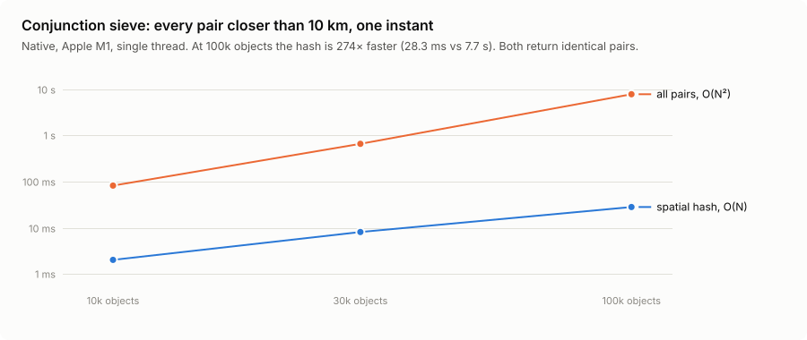
</picture>

## Validation

<picture>
  <source media="(prefers-color-scheme: dark)" srcset="docs/validation/vallado-dark.svg">
  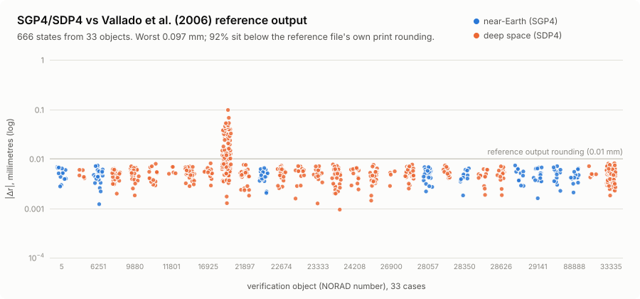
</picture>

<picture>
  <source media="(prefers-color-scheme: dark)" srcset="docs/validation/satellitejs-dark.svg">
  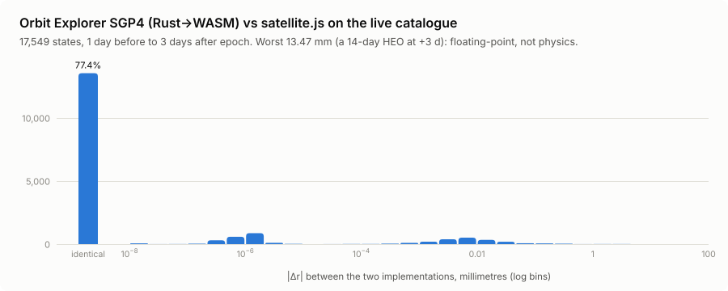
</picture>

What each test proves, and where it lives:

- `engine/tests/vallado.rs`: all 33 objects of the AIAA 2006-6753 verification set, 666 states, position error < 1e-6 km. The objects that decay or go hyperbolic must fail at exactly the step where the reference stops, with the same error codes `[1, 1, 6, 6, 4, 3, 6]`. (The reference `tcppver.out` prints the *previous* object's state when an object fails at t = 0; the harness detects and drops those stale rows.)
- `engine/tests/reference_crate.rs`: independent Rust implementation, AFSPC mode, 1,343 states.
- `web/src/engine.crosscheck.test.ts`: the compiled WASM against satellite.js on ~2,500 catalog objects × 7 times (−1 d … +3 d).
- `engine/src/sun.rs`: Meeus example 25.a (RA/Dec to 0.02°); sunrise at London and New York on both solstices within 2 minutes of published tables.
- `engine/src/conjunction.rs`: the sieve must return identical encounters at 10 s and 60 s steps, and must catch a transfer-orbit object passing a LEO satellite head-on at ~18 km/s between two 120 s samples (the case a single 16 km/s bound let through). Splitting the window into 2, 3 or 7 parts and merging by pair must give exactly the single pass.
- `engine/src/grid.rs`: the grid finds exactly the brute-force pairs and neighbors, including for clusters millions of cells apart, where cell numbers are clamped.
- `web/src/sim/keyframes.test.ts`: measures the interpolation error quoted above against exact SGP4.
- `web/src/sim/solar.test.ts`: the Moon, Mars and the Sun against JPL Horizons vectors at three dates, and both worlds' rotation against Horizons' sub-Earth points.
- `web/src/sim/planets.test.ts`: Mercury to Neptune against Horizons at three dates (direction ≤ 10″, distance ≤ 2×10⁻⁵), and each planet's sub-Earth longitude against Horizons' to 0.2°, light time included.
- `web/src/sim/ephemeris.test.ts`: every world's snapshot is complete, bound and above the surface; dropping every other sample and interpolating must land within 50 m of JPL's value for 99.9% of samples (Hermite error scales with step⁴; one maneuver or kernel seam may stand out, never past 200 m); two-body motion for five irregular moons stays within 0.1% of Horizons after 12 days; the Voyagers' paths reach past the heliopause.
- `web/src/sim/relay.test.ts`: the Earth never sets at Tranquility Base and never rises at Chang'e 4's far-side site; at Jezero it is up for 8–16 h of a sol; MRO's passes last minutes.
- `web/src/scene/travel.test.ts`: a flight between worlds starts and ends exactly where planned, never enters either body, and never jumps by more than a few percent of the current scale; so does the long zoom out to the Oort cloud and back in to Neptune.

## How it works

```
             every deploy (6 h)
 CelesTrak or Space-Track ──────► catalog.bin  (1.9 MB at 32.6k objects: f64 epoch + mean motion, f32 angles, SoA)
                                       │
                               main thread (React + Three.js)
                                       │ decode
      ┌────────────────────────────────┼─────────────────────────────┐
      ▼                                ▼                             ▼
 4 × SGP4 worker                 analysis worker                1–4 × conjunction worker
 (Rust → WASM)                   (Rust → WASM)                  (Rust → WASM)
 propagate slice ──► SharedArrayBuffer   Starlink subset:        whole catalog, a time slice each:
 Atomics.wait/notify, keyframes   │      +Grid graph, Dijkstra,  spatial grid → linear TCA →
 no messages per frame            │      coverage caps           Newton on SGP4 states
                                  ▼            │ 4 Hz                    │ streamed progress
                  render loop (SceneController, plain Three.js, WebGPU/TSL)
                  Hermite interpolation → camera-relative instances → bloom
                                  │ ~5 Hz summaries
                                  ▼
                        Zustand store → React HUD → D3 panels

             same deploy
 JPL Horizons ───────────────────► ephemeris-{9 worlds}.bin  (0.1–1 MB each: 12 days of position +
                                   velocity per spacecraft and fast moon, elements for irregular moons,
                                   the Voyagers' paths since 1977)
 JPL Small-Body Database ────────► tno.bin  (7,299 trans-Neptunian orbits, refreshed monthly)
```

**Simulation state never lives in React.** The render loop is a plain `SceneController` class that owns the renderer, the animation loop and the workers. React starts it from one `useEffect` and afterward only reads summaries (clock, selected object, route latency, screening progress) that the scene publishes to a Zustand store about 5 times a second. Each D3 panel is a `<div>` React renders once and never touches again.

**SGP4 runs at 1–12 Hz, not per frame.** Four workers propagate their slice of the catalog straight into a `SharedArrayBuffer` with four keyframe slots. The main thread requests a keyframe by writing a Julian date and bumping an `Int32` with `Atomics.notify`. Workers blocked in `Atomics.wait` wake up, propagate, and bump a done-counter. No `postMessage` happens per keyframe and nothing is copied. Each frame interpolates every object between two keyframes with a cubic Hermite spline on position and velocity, a 4th-order method whose measured error is quoted above. Keyframe spacing scales with time warp (1 s at real time, 300 s at 1 h/s). The **selected object is propagated exactly every frame**, and the routing and screening workers always use exact SGP4 states.

**Exact to the model, not to the bit.** SGP4's reference code computes an angle with `atan2` only to take its sine and cosine again, wraps angles with a slow exact `fmod`, and calls sin/cos on every Kepler iteration. Orbit Explorer replaces these with exact identities: the angle-difference formulas, a fast wrap, and a Taylor step once Newton's correction is tiny. That makes propagation ~25% faster. The cost is rounding: states that matched satellite.js bit for bit now differ by a median 2 nm, a billionth of a TLE's own ~1 km error. Everything that matters is unchanged: the Vallado set still agrees to 0.10 mm, the large differences from satellite.js are the same, and conjunction screening finds the same encounters to the meter.

**Camera-relative rendering.** JavaScript numbers are already float64, so WASM here is about speed, not precision. The precision problem is on the GPU: float32 resolves ~0.5 m at 7,000 km from Earth's center, which is visible jitter when the camera follows a satellite from a few hundred kilometers away. So every instanced layer (satellites, stars, links, route, orbits) is placed *at the camera*, and each instance stores `position − camera`, subtracted on the CPU in float64. Near the camera the offsets are small and exact; far away the float32 error is sub-pixel. The model-view matrix is then just the camera rotation, which three.js composes in float64. The trade-off is re-uploading the satellites' offsets every frame: 0.38 MB for 32.6k satellites, measured. Colors and sizes upload only when they change, and the star field, whose offsets never change, only once. (three.js re-uploads every `DynamicDrawUsage` buffer each frame whether it changed or not, so the layers don't use it.)

**Laser mesh.** Starlink's real inter-satellite topology isn't public, so Orbit Explorer models the +Grid used in the ISL literature: two in-plane links (fore and aft) plus one to the nearest satellite in the next plane east. Nothing is labeled. Every update, the analysis worker clusters mean inclination, then mean altitude (gaps > 0.08° and > 6 km), into shells. Shells under 200 satellites are launch batches still raising orbit, and get no links. It then clusters RAAN on the circle into planes (gaps > 0.9°) and orders each plane by argument of latitude. On the October 2026 catalog this recovers seven shells, including the 4,640-satellite 53.2° shell at 464 km in 100 planes. Links must stay above 80 km altitude end to end, and are capped at 2,600 km in-plane and 1,500 km cross-plane. Routing adds the two ground terminals as graph nodes, connected to every shell satellite above 25° elevation. Latency is the path length divided by c.

**Other worlds.** There are no TLEs beyond Earth, and SGP4 models Earth's gravity and air, so orbiters elsewhere use their missions' own trajectories: the navigation teams' reconstructions and predictions, as served by JPL Horizons. Every deploy samples them and the scene Hermite-interpolates, as it does for SGP4 keyframes. Moons come from JPL's satellite ephemerides the same way, and the roster of every known moon (names, ids, who found them and when) from JPL's satellite tables. The ~400 small irregular moons circle in months to years, so each gets one set of osculating elements instead of a thousand samples. Over the snapshot's window the Sun barely bends their orbits: two-body motion stays within 0.1% of Horizons. One moon announced in 2025, S/2025 U1, isn't in JPL's kernels yet; its number belongs to an asteroid in Horizons, so the fetch checks every answer is actually near its planet and skips it. BepiColombo isn't in orbit yet: until its capture in late November 2026 the Sun shapes its path as much as Mercury does, so it gets a longer window (20 days back, 30 ahead), is drawn along that trajectory alone rather than as an ellipse, and its card shows its approach instead of a period. A spacecraft counts as in orbit once its whole osculating ellipse fits inside half the world's Hill sphere.

The worlds themselves come from compact analytic series, so they're available at any date: MiniMoon plus the largest Meeus distance terms for the Moon, Standish's Keplerian elements for Mars and the Earth–Moon barycenter, and VSOP87 for Mercury, Venus and the giants. Standish's elements are 5′ off for Saturn, whose orbit Jupiter's pull bends, so VSOP87 (Bretagnon & Francou), truncated to the terms above 0.4″, puts all six within a few arcseconds; the Earth they're seen from comes from VSOP87 too, since 20″ in the Earth's position is 35″ in Venus' at its closest. Horizons and the IAU rotation models are in ICRF (J2000), so they're precessed to the scene's equator of date, as are the stars and the Milky Way (0.36° in 2026).

Distances span 10¹⁴ km, from a followed spacecraft's hull to the far side of the Oort cloud. The scene's origin is wherever precision matters: the center of the world in focus, re-anchored every frame because Mars moves at ~20 km/s relative to us; in transit, the camera itself; and beside a Voyager, 2.5×10¹⁰ km from the Sun, the Voyager (some GPU paths compose matrices in float32 and lose kilometers that far out). Anything beyond 700,000 km is pulled toward the camera along its line of sight to a compressed distance D₀(1 + ln(d/D₀)/8), which leaves its place on screen unchanged and keeps depth order, so the far side of the Oort cloud lands at 2.4 million km, inside the far plane (`scene/far.ts`). Worlds are scaled by the same factor, keeping their angular size and lighting. Below a few pixels across a world becomes a point of light at its apparent magnitude (Mallama & Hilton's phase laws, Saturn's rings included), so Jupiter is a bright star from Earth and the Sun, from the Oort cloud, is a star of magnitude −3.

**Flying between worlds** is planned in log-distance (`scene/travel.ts`). The camera rises off one world, its distance growing geometrically while it swings around to the side facing the destination and turns to look at it. It then falls toward the destination, distance shrinking geometrically, and swings around to the lit side, 50° off the Sun and toward its sunlit pole, so the terminator shows the relief and Saturn's rings show their lit face. Time is split between the two halves in proportion to their log-distance ranges, so the speed is continuous where they meet. That takes ~2.6 s to the Moon, ~5 s to Mars and ~6 s to Neptune. The Oort cloud's view is 60,000 au out but its center, the Sun, is 1 au from the Earth, so there is no halfway to fall from: that flight is one long zoom, the center sliding from the Earth to the Sun once the camera is several au out.

**Conjunction screening.** Two objects that pass within `d` at their time of closest approach are, at the nearest sample, at most `d + v_rel·Δt/2` apart, and v_rel is at most the sum of the two objects' top speeds, their speeds at perigee. 95% of the catalog never exceeds 8 km/s, so any two of those close at under 16 km/s, and that bound sizes the cells of the spatial grid. The other ~1,700 objects (transfer orbits, Molniyas, eccentric debris) each search their own wider radius, from their top speed plus the fastest object's. A single 16 km/s bound once let a transfer-orbit rocket body slip past a LEO satellite at 16.8 km/s between samples; a test now pins that case. With both radii the sieve cannot miss anything between samples, and the step-size independence test is the proof in practice. Each candidate pair gets a linear TCA estimate, and pairs whose estimate lands in the current window are refined by Newton iterations on d/dt |Δr|² = 0 using full SGP4 states. Pairs already inside the threshold at a sample are always refined, because for slow pairs the linear estimate is ill-conditioned. Pairs slower than 10 m/s are docked vehicles or formations (the ISS modules, for example) and are counted, not reported. Time samples are independent, so the browser splits the window across up to four workers, each screening a contiguous share of the samples, and merges their encounters by pair, keeping the smallest miss: exactly what one pass over the whole window finds.

## The interface

The globe fills the screen; the interface is a few pieces of type and thin-lined black panels that appear when needed, in a monochrome, uppercase-labeled style after SpaceX's mission graphics. Color is reserved for data.

- **The opening view** looks down on North America. The location button under the zoom controls flies to you instead, after the browser asks; once you've allowed it, the app opens there. Your position is rounded to a whole degree, only aims the camera, and never leaves the page; **R** comes back to it.
- **Modes** across the top: Explore (just the globe), Routing, Conjunctions, Coverage and Catalog. Each opens one panel on the right; the globe re-centers into the space that is left by shifting the projection, not the camera.
- **⌘K** opens one search box for every object in the catalog (by name, or by NORAD ID typed as `100855`, `#100855` or `NORAD 100855`, matching as you type), well-known objects and view actions.
- **Away from the Earth**, the key under the headline doubles as switches: **Moons** hides every moon but the selected one, so the spacecraft among Jupiter's 115 moons are easy to find and pick, and **Orbits** (off at first) draws every orbiter's track, and the planets' from afar.
- **Selecting** an object shows its live state and always draws its orbit, fading behind it and bright ahead. **Follow** flies the camera there along a great-circle arc and rides along; stopping zooms back out with the object still centered. Selecting a conjunction draws both objects' orbits, so the crossing geometry is visible.
- **The time bar** is a mission timeline: ±24 h around now, with each screened conjunction marked where it happens. Click one to jump to 90 s before closest approach.
- **Every world** is listed top right under *Fly to*, outward from the Sun with the Moon under the Earth, with how far each is from the world you're at now (a mode's panel takes its place; on a phone the worlds are a strip in the header): click one to fly there (also **E**, **M** and **.** for the Earth, the Moon and Mars, **[** and **]** to step inward or outward, or click a world's name where it hangs in the sky). The panels change with the world: elsewhere, **Orbiters** (or **Moons & craft**) lists what is there with live distance and period, the big moons first and the rest folded into inner and captured irregular moons. Around the Moon and Mars, **Link to Earth** charts the next 24 hours at a landing site. It shows when the Earth is above the horizon (never at Chang'e 4 on the far side, always at Tranquility Base) and when each relay orbiter passes, with the one-way light time. The big moons are mapped globes, the small ones cratered bodies, and spacecraft get a model when followed: the Voyagers, Juno and BepiColombo their own.
- **The Oort cloud** is the solar system seen from outside: the planets' and dwarf planets' orbits, the Voyagers' paths bending past the giants, the Kuiper belt, the termination shock and heliopause where the Voyagers crossed them, and the cloud itself, with distance rings in light-time from 1 to 100,000 au. Each part appears at the scale where it means something. **Voyager 1 and 2** are in the catalog: the Catalog panel lists them under *Beyond Earth orbit*, and **⌘K** finds them by name or by their NORAD numbers, 10321 and 10271.
- **Venus** is drawn as it looks, a pale deck of cloud turning every four days; the **Radar surface** layer shows Magellan's map of the ground beneath.
- **Layers** toggle the laser mesh, route, terminal visibility cones, coverage heatmap and the sky, and choose the reference frame: *Rotate with Earth* (ground fixed, satellites sweep over it) or *Fixed to stars* (orbital planes fixed, the Earth turns beneath them).
- **Object groups** use Paul Tol's high-contrast scheme (Starlink blue, other satellites yellow, debris red), whose hues also differ in lightness, so they survive color-blindness and grayscale. The dark blue is lifted on the globe and ringed in the legend to stay legible against black.


<p align="center"><sub><b>Link to Earth</b> at Jezero: the next 24 hours of daylight, direct contact with the Earth and passes by each of the five orbiters.</sub></p>

**Each Starlink is drawn as its hardware generation.** The NORAD ID says which launch a satellite came from, and so which hardware it carries: V1.0/V1.5 (Falcon 9, 2019–23), V2 Mini including its Direct-to-Cell variant (Falcon 9, 2023 on), or V3 (Starship, from September 2026). Through mid-2023 SpaceX alternated V1.5 and V2 Mini launches, so the version comes from a table of ID ranges built from Jonathan McDowell's launch list (`starlinkVersion` in `web/src/sim/catalog.ts`), not a single cut-off. SpaceX hasn't published V3's layout; its model is an approximation from the reported ~7.5 m bus and ~60 m span.

<table>
  <tr>
    <td>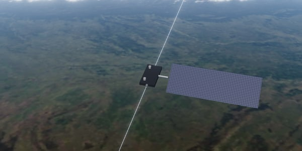</td>
    <td>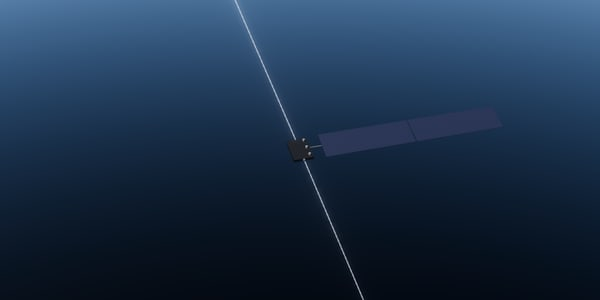</td>
    <td>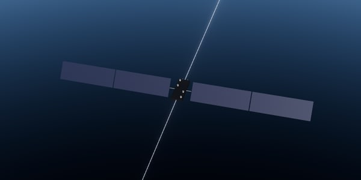</td>
  </tr>
  <tr>
    <td align="center"><sub><b>V1.5</b> · STARLINK-4190<br>~300 kg, one 8 m array</sub></td>
    <td align="center"><sub><b>V2 Mini</b> · STARLINK-33927<br>~800 kg, ~30 m array</sub></td>
    <td align="center"><sub><b>V3</b> · STARLINK-40083 (Starship flight 14)<br>~1.9 t, ~60 m across</sub></td>
  </tr>
</table>

Each close-up is framed to fit the model, so the three aren't to the same scale.

**The sky is data too.** The Milky Way is NASA SVS's *Deep Star Maps 2020* (Gaia DR2, bright stars removed) placed on the celestial sphere in the scene's equatorial frame. The stars it removed come back as the 116,833 Hipparcos stars, each drawn as a Gaussian point-spread function sized in device pixels from its V magnitude and colored by B−V, so they stay sharp on 4K screens. The Sun sits where the engine puts it, at its true 0.53° with limb darkening, and sets behind the Earth's limb.

**The planets beyond Mars** (`scripts/worlds.mjs`, 2k and 4k only). Mercury is MESSENGER's 3-color basemap with the USGS MESSENGER elevation model, Venus Magellan's radar mosaic and topography. Jupiter, Saturn, Uranus and Neptune are Hubble's OPAL global maps from 2025, whose latitudes are converted for the flattened globe (Saturn is 10% wider than it is tall). Hubble couldn't see everything: Saturn's equator hides in its rings' shadow, and Uranus' south and Neptune's far north are turned away in winter, so those rows are filled from the bands' own average color, and Saturn's north polar hexagon is painted at its 78°N. Hubble's filter sets aren't true color: Uranus and Neptune are balanced to the pale greenish blue Irwin et al. measured in 2024, Saturn to butterscotch. Saturn's rings, and the faint ones of Jupiter, Uranus and Neptune, are built from their measured edges and optical depths; the planet shades its rings and the rings shade the planet. The big moons are USGS mosaics from Galileo, Voyager and Cassini. Voyager 2 saw only the southern halves of Uranus' five big moons (1986) and of Triton (1989), the north dark in winter, so their maps are Voyager's south completed: the unseen part takes its broad brightness from the edge of what was seen and its fine texture quilted from small patches of the moon's own sharpest terrain, each too small to repeat a landmark, and the same texture is laid lightly over terrain Voyager only saw from far off. Triton's mosaic is in Voyager's enhanced color, so only its brightness is kept, in Triton's true peach-gray with a pinker polar cap.

**The Moon and Mars** use the same tile pipeline (`scripts/planets.mjs`). The Moon is LRO's wide-angle color mosaic with LOLA's 64 px/° elevation model. Mars is the Viking Orbiter color mosaic (925 m/px) with MOLA's 32 px/° elevation. The elevation is baked into slope maps that the shader lights with the real Sun, so craters and canyons cast shadow at the terminator. Reflectance is Minnaert's law, with k = 0.5 for the Moon (the full Moon is a flat disc, with no darkening at the limb) and 0.8 for Mars.

**Imagery** streams in sharper each step: 2k JPEG at first paint, then 4k KTX2, then on high-density displays a 16384×8192 Earth (Blue Marble NG by day, 500 m Black Marble lights by night) and a 16k sky, each as a 4×4 grid of 4096×2048 tiles because WebGPU only guarantees 8192-pixel textures. Tiles facing the camera load first. Basis builds mipmaps with wrap-around addressing by default, which drew faint lines along tile seams at lower mip levels; the texture scripts switch it to clamping.

## What the data says

- **Starlink is its own biggest traffic hazard.** Of the 2,981 sub-5 km encounters in the next hour, 55% are Starlink–Starlink, and 68% of all of them happen at more than 10 km/s, between crossing planes of the dense 450–485 km shells. Another 30% involve debris or a spent rocket body, which only the full catalog shows. A density estimate (5,000 satellites in a ~10 km-thick shell, σ = π·5², v ≈ 10 km/s) predicts thousands per hour unless phasing is actively maintained. TLE errors are ~1 km, so these are screening hits, not collision probabilities.
- **Light in vacuum beats glass past a few thousand kilometers.** Ignoring slant range and grid zig-zags, the break-even is where the climb to the shell and back down (2h) equals the fiber penalty: 2h / (n − 1) ≈ 2,000 km for a 480 km shell with n = 1.468. Real uplinks at 25° elevation and +Grid staircases push it toward ~3,000 km. London–New York saves ~6 ms one way, and the saving grows with distance.
- **Coverage is total, and uneven.** Every point on Earth sees at least 6 Starlinks above 25°, 46 on average, but density peaks near ±50° where the 53° shells turn around.

## Run it

Requires Rust (with `rustup target add wasm32-unknown-unknown`), Node 24 and pnpm 10.

```sh
pnpm install
pnpm dev            # fetches the snapshots on first run, builds the WASM engine, then serves http://localhost:5173
pnpm test           # cargo test (engine) + vitest (web, incl. the satellite.js cross-check)
pnpm validate       # regenerate docs/validation/*.svg
pnpm bench          # native benchmarks → docs/benchmarks-native.json
pnpm data           # refresh the catalog snapshot from CelesTrak (cached; respects its 2 h update cycle),
                    # then every world's orbiters and moons from JPL Horizons, and the Kuiper belt from
                    # JPL's Small-Body Database. The snapshots aren't in git:
                    # dev, build, test and bench fetch them once if missing, and only this refreshes them
pnpm --filter web textures   # Earth imagery: 2k, 4k and 16k (4x4 tiles of 4096x2048) KTX2 tiers + ocean mask
pnpm --filter web sky        # Milky Way (16k, tiled) and the Hipparcos star catalog
                             # (both download ~700 MB of NASA/ESA sources once, cached in data/cache/)
pnpm --filter web planets    # Moon and Mars color + relief tiers (downloads ~2.2 GB of NASA/USGS sources once)
pnpm --filter web worlds     # Mercury, Venus, the giants and their big moons (downloads ~3 GB of USGS and Hubble OPAL maps once)
pnpm --filter web vsop       # regenerates src/sim/vsop87.ts from the IMCCE VSOP87 files
```

In the app: drag to orbit, scroll to zoom, click a satellite to select it. **⌘K** (or **/**) searches objects, orbiters, every moon, worlds and actions, **E**, **M** and **.** fly to the Earth, the Moon and Mars, **[** and **]** step inward and outward through the worlds, **1–5** switch between Explore, Routing, Conjunctions, Coverage and Catalog (elsewhere: Explore, Orbiters, and Link to Earth at the Moon and Mars), **F** flies to the selection and follows it, **Esc** zooms back out, **R** resets, **L** opens layers, **H** hides the interface, **Space** pauses. The Conjunctions view's *Watch it happen* jumps the clock to 90 s before the closest approach and rides along with the first object, with both objects' orbits drawn.

Imagery streams in sharper each step: 2k JPEG at first paint, then 4k KTX2, then, on displays at least ~2560 device pixels across, 16k Earth and sky as 4x4 grids of tiles, nearest-to-view first. `?quality=uhd` or `?quality=standard` overrides the choice.

The page must be **cross-origin isolated** (`COOP: same-origin`, `COEP: require-corp`) for `SharedArrayBuffer`. The Vite config sends the headers in dev and preview, and `web/public/_headers` does the same on Cloudflare Pages or Netlify. GitHub Pages can't set headers, which is why `.github/workflows/deploy.yml` targets Cloudflare Pages.

## Layout

```
engine/          Rust → WASM: sgp4, frames, sun, grid, conjunction, isl, coverage, batch
  tests/         Vallado verification set, sgp4-crate cross-check
  examples/      validate (error CSV), bench (native benchmarks), screen (time the default screen, diff its encounters)
web/             Vite + React 19 + Three.js (WebGPURenderer, TSL) + D3
  src/scene/     SceneController (camera flights, follow), tiled Earth shader, sky (Milky Way, stars, Sun), camera-relative sprite/line layers,
                 Moon/Mars/Mercury/Venus globes and small moons (planet), giants, rings and mapped moons (giants),
                 the heliosphere and Oort cloud (heliosphere), far-distance compression (far), worlds and orbiters (system),
                 flights between worlds (travel)
  src/workers/   SGP4 pool (SharedArrayBuffer), analysis (links/routing/coverage), conjunctions (coordinator + time-slice parts)
  src/sim/       snapshot decoder, keyframes + Hermite, clock, physics, cities; Moon/Mars/Sun series and IAU rotation (solar),
                 VSOP87 planets and IAU 2015 rotation (planets, vsop87), Horizons snapshots: tracks, elements, paths (ephemeris),
                 relay passes (relay), worlds, orbiters and sites (bodies)
  src/ui/        React HUD: header, mode panels, ⌘K palette, timeline     src/panels/   D3 charts in React-owned containers
  scripts/       NASA textures → JPEG + tiled KTX2, sky (Milky Way map, Hipparcos stars), Moon/Mars color + relief,
                 Mercury/Venus/giants/moons (worlds), VSOP87 truncation (vsop), validation/benchmark plots
data/            snapshot builders: CelesTrak (or Space-Track with credentials), JPL Horizons, JPL Small-Body Database
docs/            validation plots, benchmarks, blog draft
.github/         CI, Cloudflare Pages deploy (on push, and every 6 h with fresh snapshots)
```

## Limits, stated plainly

- **The full catalog needs a Space-Track account.** Without one, CelesTrak publishes active payloads plus the major debris clouds, about 20k objects. With `SPACETRACK_USER`/`SPACETRACK_PASS` set, `data/fetch-tles.mjs` pulls the full public catalog instead: 32,583 objects on Oct 9, 2026, including ~2,100 rocket bodies and ~11,600 pieces of debris that CelesTrak's groups leave out. The screenshots and the *Numbers* section above use it. The engine is benchmarked to 100k synthetic objects.
- **TLE accuracy is ~1 km** at epoch and grows by km/day; SGP4 is exact to its own model, not to reality.
- **The laser topology is a model.** +Grid is the standard assumption in the literature; SpaceX's actual link scheduling is not public. The fiber comparison is deliberately the physical best case for fiber.
- UT1 is taken as UTC (≤ 0.9 s), polar motion is ignored (< 15 m), and the Sun uses the Astronomical Almanac low-precision series (0.01°).
- **Rendering is GPU-bound and doesn't adapt yet.** The canvas always renders at the display's density (up to 2×), with a half-resolution bloom pass on top. On an M1 driving a 4K external display that measured 12–18 fps in Zen (Firefox) and roughly 25–40 fps in Chrome. Adaptive resolution and a cheaper bloom are the planned fixes.
- **The UHD imagery is heavy:** ~29 MB of tiles for the Earth and sky (18 MB of it the sky), plus 33 MB for the Moon and 18 MB for Mars. Tiles download only on high-density displays, and a world's tiles only when you go there. The other planets stop at 4k: they are small on screen, and Hubble's maps of Uranus and Neptune are only 721 pixels across.
- **Beyond Earth, a trajectory is only as current as its mission's last prediction.** The snapshot covers 2 days back and 10 ahead, and some kernels end sooner, so an orbiter disappears when you scrub past its window, and its card says so. Predictions change at every maneuver. MAVEN (silent since late 2025), Tianwen-1 and the Queqiao relays aren't in Horizons, so they aren't shown.
- **The worlds' positions are analytic**, good to about an arcminute over this century. That's far below what the scene can show, but it isn't JPL's DE440. Mars' rotation uses the IAU 2009 model, and the Moon's uses its full libration series.
- **Phobos' and Deimos' shapes are made up**: true sizes and orientation, with generated craters (plus Stickney on Phobos), not the shape models. So are the giants' small moons, sized from their measured radii or, for most irregulars, from their brightness at a coal-dark albedo.
- **Some maps are made, not measured.** No global visible-light map of Venus' cloud tops exists, so its pale deck is generated (the Magellan radar map underneath is real). The northern halves of Uranus' five big moons and of Triton, which Voyager 2 never saw, are generated from the terrain it did see. Saturn's north polar hexagon is painted where Hubble's map stops, and the giants' maps are filled where Hubble couldn't see.
- **The Oort cloud is a model.** Nothing in it has ever been observed; it is inferred from long-period comets. The 50,000 points follow the usual picture (density ∝ r^−3.5, an inner cloud from 2,000 to 20,000 au, an outer one to 100,000 au), and the heliosphere's boundaries are smooth shapes through the Voyagers' crossing points. The Kuiper belt is real: every known trans-Neptunian object, on its own orbit.
- **The giants' cloud maps are snapshots.** Jupiter's turns with System II from the date Hubble mapped it (December 2025), which keeps the Great Red Spot near where it really is for a year or two; elsewhere the clouds drift from where the map put them. Irregular moons move by two-body motion from elements up to a week old, good to ~0.1% over the snapshot's window.
- **Not every moon:** S/2025 U1, announced in 2025, isn't in JPL's ephemerides yet. Nothing orbits Venus: Akatsuki's trajectory ends in August 2025.

## Credits & licenses

Orbital elements: [CelesTrak](https://celestrak.org) GP data, or the full public catalog from [Space-Track.org](https://www.space-track.org) when credentials are set (snapshotted at each deploy, every 6 hours, never fetched at runtime). Starlink hardware generations: Jonathan McDowell, [planet4589.org](https://planet4589.org/space/con/star/stats.html) (CC-BY). Earth imagery: NASA Blue Marble Next Generation and Black Marble 2016 (public domain). Milky Way: NASA/Goddard Space Flight Center Scientific Visualization Studio, *Deep Star Maps 2020*, built on Gaia DR2 (ESA/Gaia/DPAC). Stars: the Hipparcos main catalog (ESA 1997, CDS I/239). Moon: NASA LRO, LROC WAC color mosaic and LOLA elevation, via the NASA SVS *CGI Moon Kit*. Mars: Viking Orbiter color mosaic (USGS Astrogeology) and MGS MOLA MEGDR elevation (NASA PDS). Trajectories of every orbiter, moon and the Voyagers, and the moons' rosters and discoveries: [JPL Horizons](https://ssd.jpl.nasa.gov/horizons/) and the JPL SSD satellite tables (Solar System Dynamics Group). Kuiper belt: [JPL Small-Body Database](https://ssd-api.jpl.nasa.gov/doc/sbdb_query.html). Planets: VSOP87 (Bretagnon & Francou 1988, IMCCE). Mercury: MESSENGER MDIS and the USGS MESSENGER DEM; Venus: Magellan C3-MDIR mosaic and topography; moons: Galileo, Voyager and Cassini global mosaics (USGS Astrogeology; Mimas: DLR; Uranus' five: USGS Voyager 2 mosaics via [JPL's Solar System Simulator](https://maps.jpl.nasa.gov/tmaps/uranus.html)). Jupiter, Saturn, Uranus and Neptune: Hubble OPAL global maps (Simon et al., NASA/ESA HST program GO13937, archived by STScI, [doi:10.17909/T9G593](http://dx.doi.org/10.17909/T9G593)); true color of Uranus and Neptune after Irwin et al. 2024, MNRAS 527, 11521. Rotation of the planets: Archinal et al., *Report of the IAU WGCCRE: 2015*. Rotation: Archinal et al., *Report of the IAU WGCCRE: 2009*. Moon series: Montenbruck & Pfleger, *Astronomy on the Personal Computer*, and Meeus, *Astronomical Algorithms*. Planets: Standish, *Keplerian Elements for Approximate Positions of the Major Planets*. Spacecraft models: *Hubble Space Telescope (A)* (DigitalSpace Corporation) and *International Space Station (ISS) (B)* (NASA/Michael D. Carbajal) from [NASA 3D Resources](https://science.nasa.gov/3d-resources/), used under NASA's media usage guidelines and decoded with Google's Draco (Apache-2.0); every other model, the Voyagers, Juno and BepiColombo among them, is generated in code. Object colors: Paul Tol's high-contrast scheme. Type: Barlow and Geist Mono (SIL OFL). SGP4 verification data: Vallado, Crawford, Hujsak & Kelso, *Revisiting Spacetrack Report #3*, AIAA 2006-6753. Test references only: satellite.js (MIT) and the `sgp4` crate (MIT).
